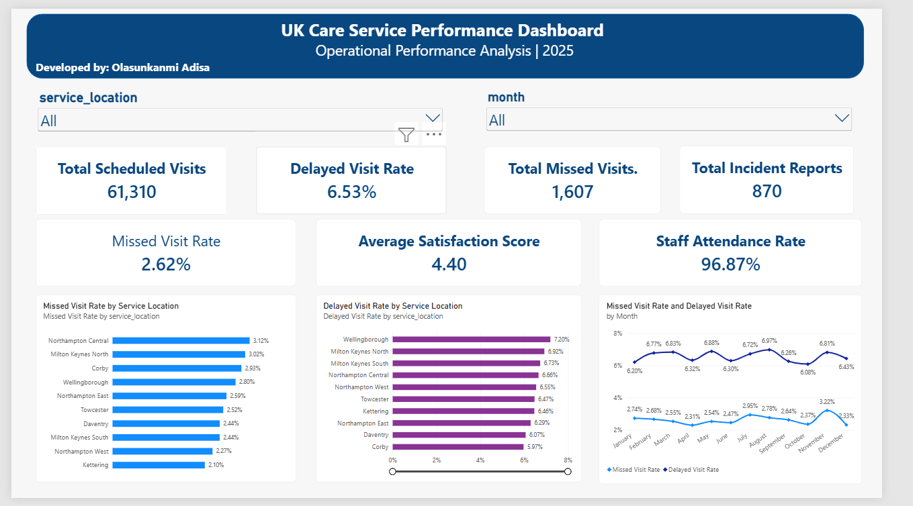

# UK-Care-Service-Performance-Analysis-2025
## Project Overview
I analysed a synthetic UK care service dataset using Excel, Python, SQL and Power BI to understand operational performance and identify areas for improvement. My aim was to investigate missed and delayed visits, staff attendance, incident reports and service-user satisfaction across different care locations.

## What I Did
I used Excel to clean and validate the data, Python to explore trends, SQL to query and summarise results, and Power BI to create an interactive dashboard.

## What I Discovered
- Missed visit rate: 2.62%
- Delayed visit rate: 6.53%
- Staff attendance: 96.87%
- Average satisfaction: 4.40/5
Northampton Central had the highest missed visit rate (3.12%), while Wellingborough had the highest delayed visit rate (7.20%).

## Recommendations
I recommend reviewing staff scheduling, investigating reasons for delayed visits, monitoring attendance and using regular performance reports to identify potential service improvements.

## Power BI Dashboard

The dashboard allows users to explore KPIs, monthly trends and performance by service location.

## Conclusion
This project helped me develop practical skills in data cleaning, analysis, SQL and visualisation while demonstrating how data can support better operational decisions

## Dataset Source
The dataset used in this project is synthetically generated UK care service data containing 1,000 records across 12 months in 2025. The dataset does not contain real patient or service-user information.

## Author
Olasunkanmi Adisa

Excel | Python | SQL | Power BI
